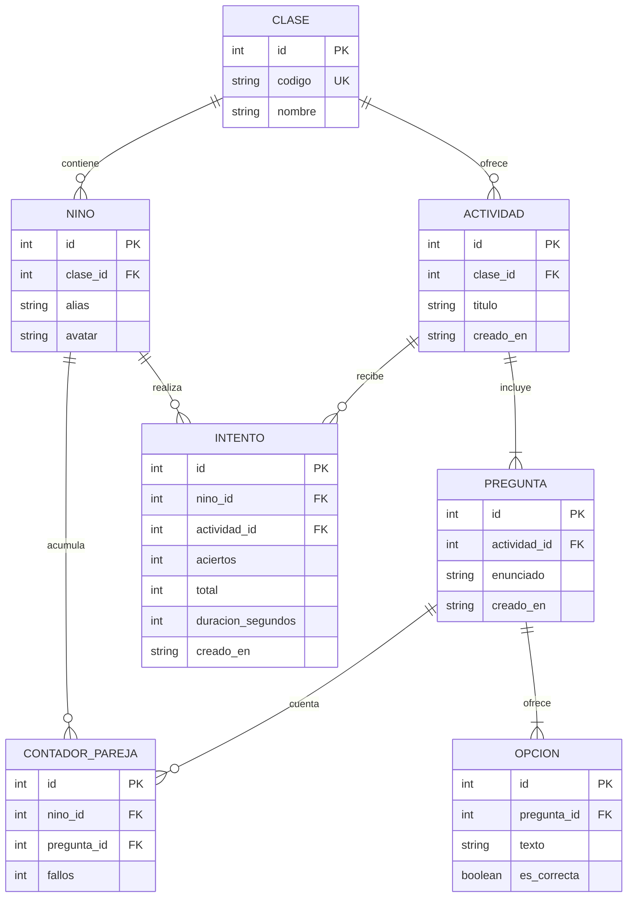

# Plan técnico

## Arquitectura

Capas: `rutas` recibe HTTP y presenta HTML o JSON, `servicios` implementa reglas de juego y progreso, `modelos` representa persistencia y las plantillas generan la interfaz.

## Modelo de datos

## Contrato de API

| Método | Ruta | Descripción | Respuesta |
| --- | --- | --- | --- |
| GET | /salud | Estado del servicio | 200 |
| GET | /api/version | Versión de la aplicación | `{"version": "<version>"}` |
| GET | /api/proyecto | Datos de identificación del proyecto | `{"aprendiz": "...", "curso": "...", "mecanica": "...", "version": "..."}` |

Las rutas siguientes son el contrato objetivo derivado de las historias; deben implementarse y probarse antes de considerarlas terminadas:

| Método | Ruta objetivo | Historia |
| --- | --- | --- |
| GET/POST/PUT | `/api/actividades` | H1 |
| POST | `/api/ingreso` | H3 |
| GET | `/api/actividades/{id}/partida` | H4, H5 |
| POST | `/api/intentos` | H4 |
| GET | `/api/ninos/{id}/progreso` | H6 |

Antes de aceptar una actividad se valida: mínimo 5 preguntas, cada pregunta con 3–4 opciones y exactamente una opción correcta.

## Decisiones

Las decisiones importantes se registran como ADR en `specs/adr/`. Las respuestas del cliente son obligatorias y tienen prioridad sobre cualquier supuesto anterior.
